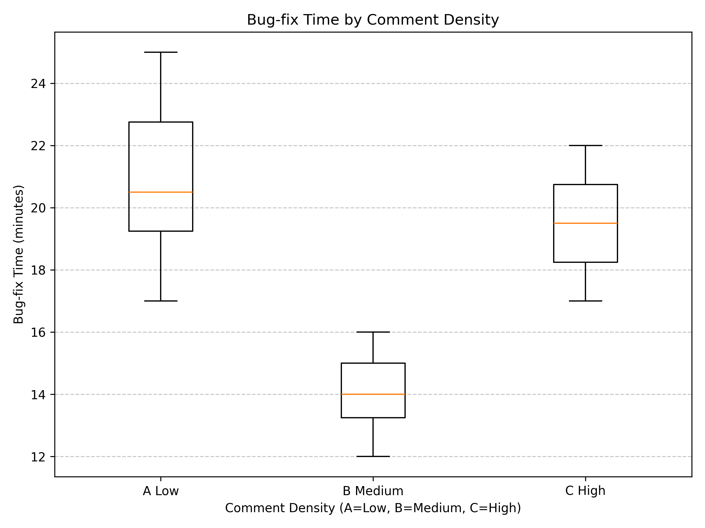

# Comment Density and Bug-Fix Time – One-Way ANOVA

A statistics exercise that tests whether the amount of code comments changes how fast developers fix a bug, using a one-way ANOVA calculated step by step and a Python box plot.

---

## Overview

**Question:** Do developers fix bugs faster when code has a low, medium, or high number of comments?

**Study design (from the assignment):**

- 30 developers, split into 3 groups of 10 (a **between-subjects** design: each person sees only one version).
- **Independent variable** (what we change): comment density – A = Low, B = Medium, C = High.
- **Dependent variable** (what we measure): time to fix the bug, in minutes.
- **Null hypothesis (H0):** there is no difference in average fix time between the three groups.

> **Note:** The data is **hypothetical**. The assignment asked us to design a study and imagine realistic data, then analyze it correctly. No real developers took part.

## What I did (solo project)

- Designed the study scenario, variables, and hypothesis.
- Calculated the one-way ANOVA **by hand**, step by step, with Excel sheets for the sums of squares.
- Made a **box plot** in Python with matplotlib.
- Wrote up the result in plain language.

## What is ANOVA? (simple explanation)

**ANOVA** (Analysis of Variance) checks if the averages of **three or more groups** are really different, or if the differences are just random noise.

It compares two kinds of spread:

- **Between groups:** how far each group's average is from the overall average.
- **Within groups:** how much people inside the same group differ from each other.

If the *between* spread is much bigger than the *within* spread, the groups are probably truly different.
The ratio of the two is called the **F statistic**. A big F means a real difference.

## The data

| Group | Fix times (minutes) | Mean | SD |
|---|---|---|---|
| A – Low | 18, 22, 20, 24, 19, 21, 23, 17, 25, 20 | 20.9 | ≈ 2.60 |
| B – Medium | 14, 15, 13, 16, 15, 14, 12, 16, 13, 14 | **14.2** | ≈ 1.32 |
| C – High | 19, 18, 17, 21, 20, 22, 19, 18, 20, 21 | 19.5 | ≈ 1.58 |

Grand mean (all 30 values) = **18.2**

## Step-by-step calculation

| Step | Formula | Result |
|---|---|---|
| Total sum of squares | Σ (each value − grand mean)² | SS_total = 348.8 |
| Within-groups SS | Σ (each value − its group mean)² | SS_within = 60.9 + 15.6 + 22.5 = 99.0 |
| Between-groups SS | Σ n × (group mean − grand mean)² | SS_between = 72.9 + 160.0 + 16.9 = 249.8 |
| Degrees of freedom | between = k − 1, within = N − k | df = 2 and 27 |
| Mean squares | MS = SS ÷ df | MS_between = 124.9, MS_within ≈ 3.67 |
| F statistic | MS_between ÷ MS_within | **F(2, 27) = 34.06** |
| p-value | from the F distribution | **p < .001** (≈ 4.1 × 10⁻⁸) |

Check: SS_between + SS_within = 249.8 + 99.0 = 348.8 = SS_total. ✔

**Decision:** p is much smaller than 0.05, so we **reject H0**. Comment density had a significant effect on bug-fix time.

## Result in plain words

- **Medium** comments were fastest (14.2 min) and the most consistent.
- **Low** comments were slowest (20.9 min) – too little help.
- **High** comments (19.5 min) were also slow – too much clutter.
- Balance is key: clear, helpful comments help most.

Note: ANOVA tells us that *at least one* group is different. To say exactly which pairs differ, a follow-up test (such as Tukey's HSD) would be the next step.

## Box plot



The code (`boxplot_comment_density.py`):

```python
data = {
    "A Low":    [18, 22, 20, 24, 19, 21, 23, 17, 25, 20],
    "B Medium": [14, 15, 13, 16, 15, 14, 12, 16, 13, 14],
    "C High":   [19, 18, 17, 21, 20, 22, 19, 18, 20, 21],
}
plt.boxplot(list(data.values()), labels=list(data.keys()))
plt.title("Bug-fix Time by Comment Density")
plt.savefig("boxplot_comment_density.png", dpi=300)
```

A **box plot** shows the middle 50% of values as a box, the median as a line, and the range as "whiskers". Group B's box is lower and smaller: faster and more consistent.

## Repository contents

```
boxplot_comment_density.py     Python box plot
boxplot_comment_density.png    the chart
total_ss_by_group.xlsx         total sum of squares, one sheet per group
within_group_ss.xlsx           within-group sum of squares (all groups)
within_group_ss_by_group.xlsx  within-group sum of squares, one sheet per group
docs/assignment3-anova.pdf     full write-up
```

## How to run

```bash
python -m venv .venv && source .venv/bin/activate
pip install matplotlib
python boxplot_comment_density.py
```

## Tech used

Python · matplotlib · Microsoft Excel · one-way ANOVA

## What I learned

- How to design a simple experiment: variables, groups, and a null hypothesis.
- How ANOVA works "under the hood", not just as a button in software.
- How to check my own math (SS_between + SS_within must equal SS_total).
- How to explain statistical results in plain language and with a clear chart.
- These are core skills for a data analyst: compare groups, test if a difference is real, and report it clearly.

**Course:** SWE 6783 User Interaction Engineering · Kennesaw State University · Fall 2025
